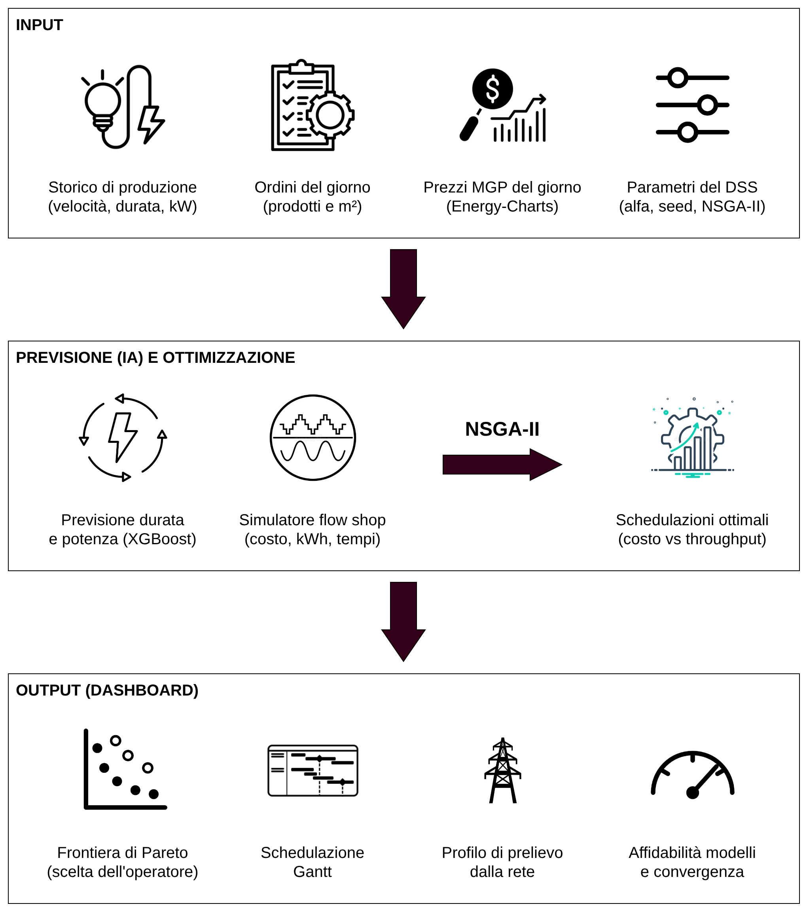

# DSS Flow Shop

**Decision Support System per la schedulazione energy-aware di un flow shop a quattro macchine**

Progetto finale del Corso di Perfezionamento in Tecnologie Digitali per Ambienti e Sistemi Intelligenti, Università del Salento (a.a. 2025/2026).
Autore: Claudio Mammino

**Pagina di presentazione:** https://unisalento-idalab-corsoperfez-25-26.github.io/perfez-2526-presentation-Mammino/

---

## Il progetto

**DSS Flow Shop** è un prototipo (Proof of Concept) di sistema di supporto alle decisioni che, per la giornata di produzione di un reparto con quattro macchine in serie, propone più programmi alternativi agendo su tre variabili:

- **sequenza** degli ordini del giorno;
- **velocità** di ogni ordine su ogni macchina;
- **pause** facoltative tra un ordine e il successivo, per spostare lavorazioni verso ore meno care.

Il problema ha due obiettivi in conflitto, **minimizzare il costo energetico** e **massimizzare il throughput** (m²/h), e due vincoli: completare la produzione entro 24 ore e mantenere un throughput almeno pari ad α volte quello della prassi attuale (baseline). Il sistema restituisce la **frontiera di Pareto** delle soluzioni non dominate: la scelta finale del compromesso resta all'operatore.

Le tecniche principali sono:

- **XGBoost** (machine learning): due modelli di regressione, addestrati sullo storico di produzione, stimano la **durata** e la **potenza assorbita** di ogni lavorazione a partire da prodotto, macchina, velocità e quantità;
- **NSGA-II** (algoritmo genetico multi-obiettivo, libreria pymoo): esplora lo spazio delle schedulazioni e restituisce le soluzioni non dominate;
- **prezzi reali** del Mercato del Giorno Prima (MGP), scaricati da [Energy-Charts](https://www.energy-charts.info/) (Fraunhofer ISE) per data e zona di mercato.

Ogni risultato è accompagnato da indicatori di affidabilità: l'errore dei modelli su dati di test e il controllo di convergenza di NSGA-II tramite ipervolume, con confronto rispetto a una ricerca casuale.

> **Nota sui dati.** I prezzi dell'energia sono reali; lo storico di produzione è generato da un simulatore con le stesse colonne di uno storico reale. Uno storico aziendale con le stesse colonne si può usare senza modificare il codice.

---

## Architettura



Il sistema è un'unica applicazione web, organizzata in tre blocchi:

| Blocco | Contenuto |
|---|---|
| **Input** | Storico di produzione, ordini del giorno, prezzi MGP del giorno, parametri del DSS (α, seed, parametri di NSGA-II) |
| **Previsione e ottimizzazione** | Modelli XGBoost per durata e potenza; simulatore del flow shop, che calcola tempi, consumi e costo di un programma; NSGA-II, che cerca i programmi migliori |
| **Output** | Dashboard web: frontiera di Pareto, Gantt della soluzione scelta, profilo di prelievo dalla rete, schede di affidabilità dei modelli e di convergenza |

Stack: Python, FastAPI, XGBoost, scikit-learn, pymoo, Apache ECharts. Tutto open source ed eseguito in locale.

### Flusso di un'ottimizzazione

1. **Dati**: generazione dello storico e degli ordini del giorno; calcolo di setup e velocità tipiche.
2. **Modelli**: addestramento dei due modelli XGBoost e misura dell'errore su dati mai visti (split 80/20).
3. **Baseline**: simulazione della prassi attuale (ordine di arrivo, velocità medie storiche, nessuna pausa).
4. **NSGA-II**: ottimizzazione bi-obiettivo con i vincoli di 24 ore e di throughput minimo; la baseline è inserita nella popolazione iniziale.
5. **Verifica**: controllo di convergenza (ipervolume) e confronto con una ricerca casuale con lo stesso numero di valutazioni.
6. **Risultati**: salvataggio della sessione (compresa una copia della configurazione usata) e visualizzazione nella dashboard.

A parità di configurazione e seed i risultati sono identici.

---

## Repository del progetto

| Repository | Contenuto |
|---|---|
| [perfez-2526-DSSFlowShop-Mammino](https://github.com/UniSalento-IDALab-corsoPerfez-25-26/perfez-2526-DSSFlowShop-Mammino) | Questo repository: l'intero sistema (backend, modelli, ottimizzatore e dashboard) |
| [perfez-2526-presentation-Mammino](https://github.com/UniSalento-IDALab-corsoPerfez-25-26/perfez-2526-presentation-Mammino) | Pagina di presentazione del progetto: [unisalento-idalab-corsoperfez-25-26.github.io/perfez-2526-presentation-Mammino](https://unisalento-idalab-corsoperfez-25-26.github.io/perfez-2526-presentation-Mammino/) |

Il DSS è un'unica applicazione: il server FastAPI contiene previsione, simulazione e ottimizzazione e serve anche la dashboard. Per questo tutto il codice è in un solo repository; il secondo repository contiene la pagina di presentazione.

---

## Questo componente: l'applicazione DSS Flow Shop

### Requisiti

- Python 3.10 o successivo
- Le librerie elencate in `requirements.txt`
- Connessione a Internet solo per scaricare i prezzi dell'energia (il calcolo funziona anche con i prezzi già salvati in `config.json`)

### Installazione

```bash
git clone https://github.com/UniSalento-IDALab-corsoPerfez-25-26/perfez-2526-DSSFlowShop-Mammino.git
cd perfez-2526-DSSFlowShop-Mammino

python -m venv .venv
# Windows:      .venv\Scripts\activate
# macOS/Linux:  source .venv/bin/activate

pip install -r requirements.txt
```

### Avvio

```bash
python app.py
```

Poi aprire nel browser **http://127.0.0.1:8000**.

### Uso

1. **Configura** (pagina `/static/config.html`): scegliere data e zona di mercato e scaricare i prezzi del giorno; impostare α, seed, numero di ordini e parametri di NSGA-II; salvare.
2. **Dashboard**: avviare un'ottimizzazione (circa 15 secondi con la configurazione di riferimento, più il controllo di convergenza) oppure caricare una sessione salvata.
3. **Analisi**: cliccare un punto della frontiera di Pareto per vederne Gantt, profilo energetico e confronto con la baseline. Grafici e dati sono esportabili in PNG e CSV.

### Configurazione

I parametri sono in `config.json`, modificabile anche dalla pagina Configura. I principali:

| Parametro | Significato | Riferimento |
|---|---|---|
| `ml_config.NP_SEED` | Seed: determina storico, ordini e casualità dell'algoritmo (vuoto = casuale) | 43 |
| `ml_config.alfa_input` | Soglia di throughput minimo rispetto alla baseline | 0,95 |
| `ml_config.nsga2_pop_size` / `nsga2_n_gen` | Popolazione e generazioni di NSGA-II | 35 / 100 |
| `ml_config.analisi_convergenza` | Controllo di convergenza e confronto con la ricerca casuale | true |
| `ordini_giornalieri` | Numero di ordini del giorno e intervallo delle quantità (m²) | 5, 3.000–12.000 |
| `potenza_ferma_frazione` | Consumo di una macchina accesa ma ferma, come frazione della potenza media in lavorazione | 0,30 |
| `prezzi_ipex_24h` | 24 prezzi orari in €/kWh (scaricati da Energy-Charts o inseriti a mano) | MGP 06/11/2026, zona Sud |
| `dataset_storico` | Parametri del generatore dello storico simulato | — |

Il file `config_doc.json` contiene la configurazione di riferimento usata per i risultati della relazione: copiandolo in `config.json` si riproducono esattamente quei risultati.

### Struttura dei file

```
├── app.py                 Server FastAPI: dashboard e API
├── config.py              Costanti del progetto e lettura della configurazione
├── config.json            Configurazione corrente
├── config_doc.json        Configurazione di riferimento (risultati della relazione)
├── data_generator.py      Generatore dello storico di produzione e degli ordini del giorno
├── ml_models.py           Modelli XGBoost per durata e potenza
├── model_validation.py    Validazione dei modelli (MAE, R², confronto con modelli semplici)
├── scheduler_engine.py    Simulatore del flow shop e ottimizzazione con NSGA-II
├── convergence.py         Ipervolume, controllo di convergenza e ricerca casuale
├── energy_price.py        Download dei prezzi MGP da Energy-Charts
├── storage_manager.py     Salvataggio e caricamento delle sessioni
├── requirements.txt       Librerie Python necessarie
├── docs/
│   └── architettura_DSS.png
└── static/
    ├── index.html         Dashboard
    ├── config.html        Pagina di configurazione
    ├── css/               Stili
    └── js/                Logica della dashboard e della configurazione (ECharts)
```

Le sessioni calcolate vengono salvate nella cartella `salvataggi_pareto/`, creata automaticamente al primo avvio.

### API principali

| Metodo e indirizzo | Funzione |
|---|---|
| `GET /` | Dashboard |
| `GET /api/run-optimization` | Esegue un'ottimizzazione completa e la salva come sessione |
| `GET /api/sessions` | Elenco delle sessioni salvate |
| `GET /api/sessions/{file}` | Contenuto di una sessione |
| `DELETE /api/sessions/{file}` | Eliminazione di una sessione |
| `GET` / `PUT /api/config` | Lettura e scrittura della configurazione |
| `GET /api/prezzi-energia?data=AAAA-MM-GG&zona=IT-South` | Prezzi orari MGP del giorno (Energy-Charts) |
